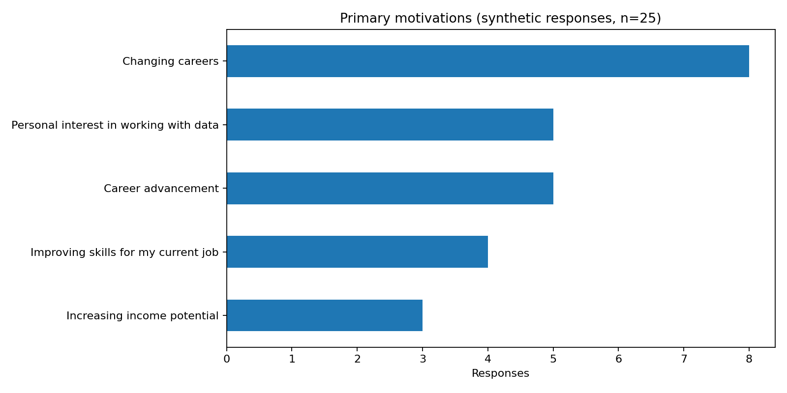
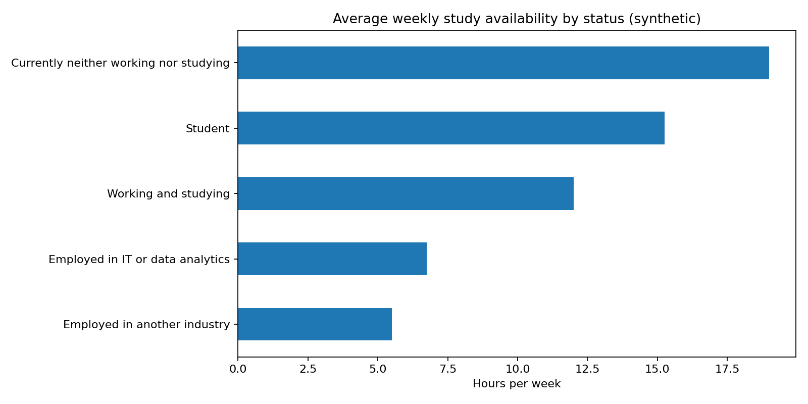
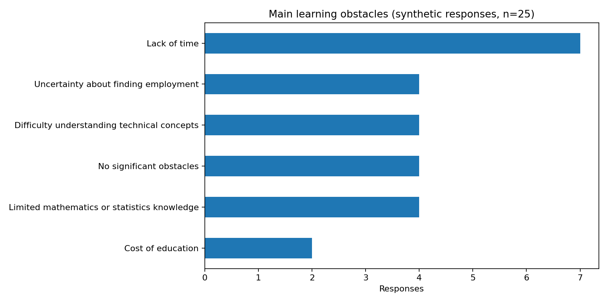

# Data Analytics Career Survey

A small data analysis project exploring career backgrounds, motivations, and learning preferences in data analytics.

## About the Project

I created a 15-question survey using Google Forms to practice collecting and organizing structured data.

The responses were connected to Google Sheets, exported as a CSV file, and analyzed using Python.

The dataset contains 25 **synthetic responses** created for testing and learning purposes, rather than responses from real participants.

## Tools Used

- Google Forms — data collection
- Google Sheets — organizing responses
- Python & Pandas — data analysis
- Matplotlib — data visualization

## Data Sources

[Google Forms — Original Survey](https://docs.google.com/forms/d/1MPdT7TCXy1W9zGEScsBSS0fHVqZGcVgQUkiSIJ8N9SE)

[Google Sheets — Survey Responses](https://docs.google.com/spreadsheets/d/15JlLBXr9PAC8nGhnLtPG0eEMViUZqG9XO93pJNNrT6Y/edit?usp=sharing)

## Analysis

I explored several questions:

- What motivates people to learn data analytics?
- What are the most common learning challenges?
- How much time can different groups dedicate to studying?

### Results

In the simulated dataset:

- 8 out of 25 profiles selected career change as their main motivation.
- 7 selected lack of time as their biggest challenge.
- Average available study time was 9.12 hours per week.

These results describe the generated dataset, not real survey participants.

## Visualizations







## Running the Analysis

```bash
pip install -r requirements.txt
python analysis.py
```

## What I Practiced

- Designing a structured survey
- Working with different data types
- Validating and collecting data
- Handling missing values
- Calculating summary statistics
- Creating and interpreting basic visualizations
